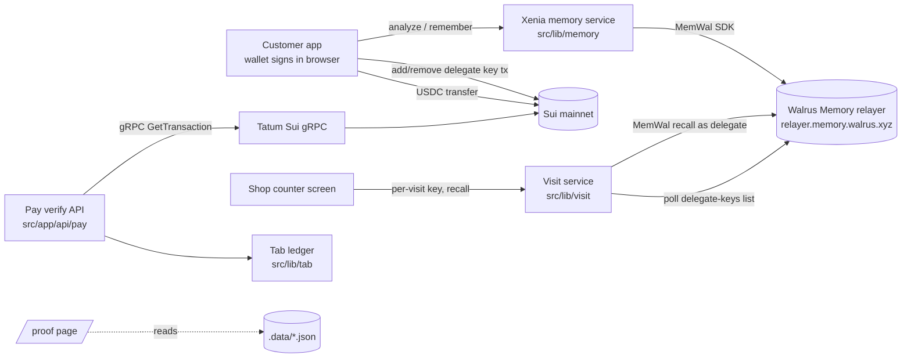

# Xenia: be a regular everywhere

Xenia (Greek for guest-friendship) gives a customer a portable, user-owned memory of how they like things. You tell the app once ("skin fade, number 2 on the sides, sensitive scalp, I settle my tab on Fridays"). Walrus Memory stores the extracted facts. At a shop you scan a QR code and grant the shop a per-visit delegate key on a shareable profile account, so the counter screen already knows your usual and anything important. You pay in USDC on Sui from your own wallet, Tatum confirms the payment landed, and the shop's tab settles. When you leave you revoke the key and the shop's reads through the relayer stop.

Track 3 (Consumer Finance Apps), Tatum x Walrus "Total Recall". Mainnet. Evidence page: `/proof`.

## The demo moment (2-3 min)
Scan, the counter screen already knows your usual, pay, the tab settles, revoke, the screen goes blank. Script: [docs/demo-video-script.md](docs/demo-video-script.md).

## Architecture



## How Walrus Memory is used
Everything goes through the `@mysten-incubation/memwal` SDK against the hosted relayer. Only what the code does:
- **remember**: `rememberAsync` plus `waitForRememberJob`, with an idempotency key derived from the text (same text never produces two blobs), a points limiter (relayer budget 60 points/min; we cap at 55) and our own timeouts. Facts are stored as dated sentences, e.g. `[2026-11-05] Usual order: ...`. See `src/lib/memory/service.ts`.
- **analyze**: free text becomes facts via `analyze`; each extracted fact is tracked until its blob id is known (`learnFromText`).
- **recall**: wrapped with an 8 s timeout and a distance cutoff of 0.5; falls back to a cached result when the live call fails. Probe queries are phrased like the stored text because recall distance is sensitive to phrasing.
- **learning** (`src/lib/memory/learning.ts`): pure functions. Newest dated fact of a kind wins, older contradicting facts are flagged superseded, a payment-habit fact is derived from 3 or more observed payments, and each suggestion carries the memories that caused it.
- **delegate keys, per visit**: `createVisit` generates a fresh Ed25519 key server-side; the customer's wallet signs `add_delegate_key` (`@mysten-incubation/memwal/account`), the service polls the relayer's `/api/accounts/:owner/delegate-keys` until the key is listed, and the shop then recalls with that key. Package and registry ids come from the relayer `GET /config`. Revoking signs `remove_delegate_key`, then the service measures how long until the list drops the key and until a shop recall is rejected. See `src/lib/visit/service.ts`.
- **two accounts**: the design is a shareable profile account (the only one a shop gets a key for) plus a separate private account, because delegate keys are not namespace-scoped. The code takes the account id from the QR payload and the profile namespace from `MEMWAL_NAMESPACE` / `VISIT_PROFILE_NAMESPACE`; creating and funding the two accounts is done by hand in the Walrus Memory dashboard, not by Xenia.
- **restore**: not used.

## How Tatum is used
Native gRPC (not grpc-web) to `sui-mainnet-grpc.gateway.tatum.io:443` via `SuiGrpcClient` + `GrpcTransport` with an `x-api-key` header (`src/lib/tatum/client.ts`), serialized to one call start per 340 ms with exponential backoff on 429.
- `LedgerService.GetTransaction` (`core.getTransaction` with balance changes): `verifyUsdcPayment` checks the transaction succeeded and credits the shop address with at least the expected USDC. The payee is always the server's `SHOP_SUI_ADDRESS`. Each digest settles a tab at most once (replay protection).
- `StateService.ListBalances` (`core.listBalances`): `getBalances`, exposed at `/api/pay/balances`.
- `NameService.ReverseLookupName`: optional SuiNS display name, fails soft.

## Honest limitations
- **Revocation is forward-only.** Access through the relayer is cut; data already read cannot be unread and old ciphertext is not re-encrypted.
- **Revocation latency is UNMEASURED in this document.** The relayer cache is believed to be around 30 s, but we only claim a number once `/proof` shows measured timings from a real revoke.
- Delegate keys are not namespace-scoped, hence the two-account design.
- The Walrus Memory SDK is beta (`0.1.x`); the app wraps it in one adapter.
- Tatum free plan: 3 requests/s. Walrus writes take about 30 s, so the UI never blocks on them.
- Local JSON files under `.data/` are the store (not production persistence).
- Demo amounts are tiny USDC. Seed data, if any, is labelled as such.

## Setup
```bash
npm install
cp .env.example .env.local   # fill in, never commit
npm run dev                  # http://localhost:3000
npm run build && npm run start
```
`.env.example` variables:
| Variable | Meaning |
|---|---|
| `TATUM_API_KEY` | Tatum mainnet key (server only) |
| `TATUM_ID` | Tatum account id, needed on the submission form only |
| `MEMWAL_PRIVATE_KEY` | Delegate private key (hex) for the profile account, server only |
| `MEMWAL_ACCOUNT_ID` | MemWalAccount object id (not a wallet address) |
| `MEMWAL_AGENT_ID` | Public key of that delegate, for the submission form |
| `MEMWAL_SERVER_URL` | Relayer, default `https://relayer.memory.walrus.xyz` |
| `MEMWAL_NAMESPACE` | Namespace for profile facts, default `xenia-profile` |
| `SHOP_SUI_ADDRESS` | Sui address that receives payments |

## Tests
`npm test` runs vitest with Walrus Memory and Tatum mocked (memory, visit lifecycle, payments/tab, SSR wallet). Mainnet writes only happen from the explicit scripts in `scripts/` (for example `scripts/integration-memory.mts`), never from tests.

## Requirement to evidence
| Hackathon requirement | Where |
|---|---|
| Walrus Memory writing on mainnet | `src/lib/memory/service.ts`, blob ids on `/proof` (`.data/memory.json`) |
| 10+ memories on mainnet | `/proof` counter "Mainnet memories: N / 10" (currently whatever the local store holds) |
| Tatum RPC for onchain data | `src/lib/tatum/client.ts`, `src/lib/tatum/verify.ts`, verified digests on `/proof` |
| Blog post | draft in [docs/blog-draft.md](docs/blog-draft.md), not yet published |
| Demo video + public repo | [docs/demo-video-script.md](docs/demo-video-script.md); video and repo link are manual |
| Submission form text | [docs/submission-answers.md](docs/submission-answers.md) |

## What we learned about Walrus Memory
- Writes take around 30 s, so every write path is asynchronous with job polling.
- Recall distance is sensitive to phrasing. A probe worded like the stored text scored about 0.18 on mainnet while a bare word scored about 0.52, so we word probes like our stored sentences and cut off at 0.5.
- Namespaces are not access boundaries, and delegate keys are not namespace-scoped, so isolation needs separate accounts.
- Memories are immutable, so "the customer changed their order" is application logic (dated text plus supersession), not an update call.
- The relayer's public `/config` and delegate-keys endpoints made the grant/revoke flow observable.
